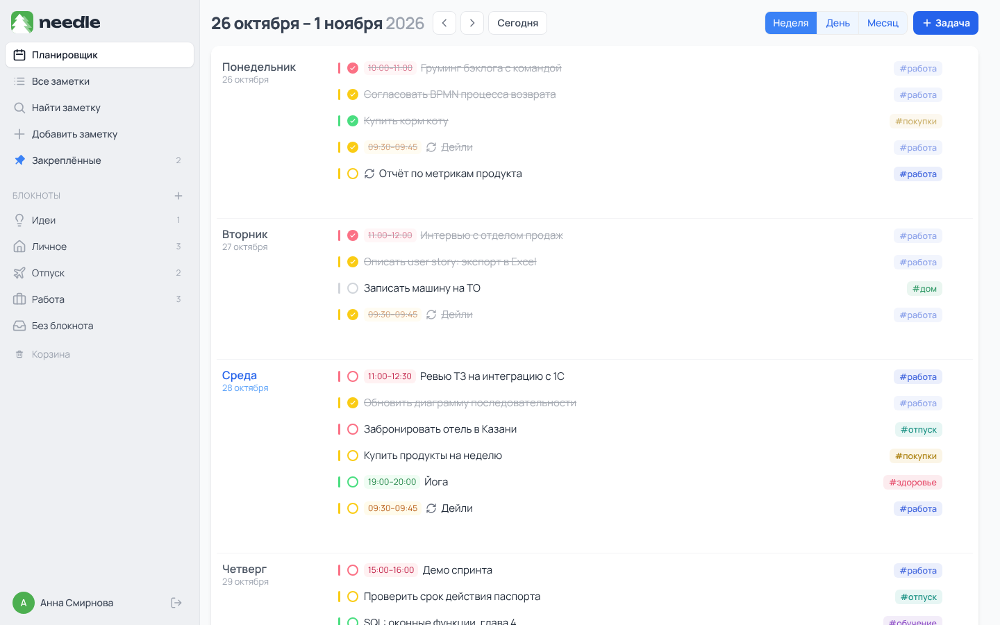
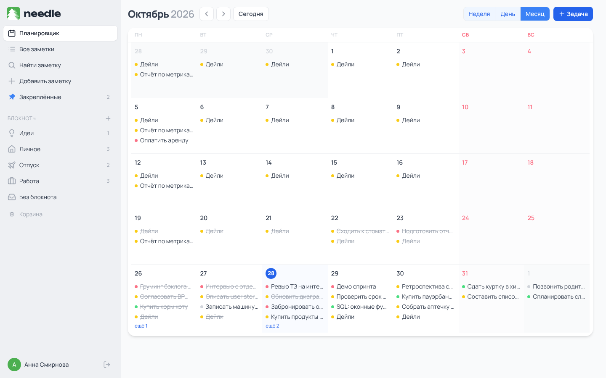
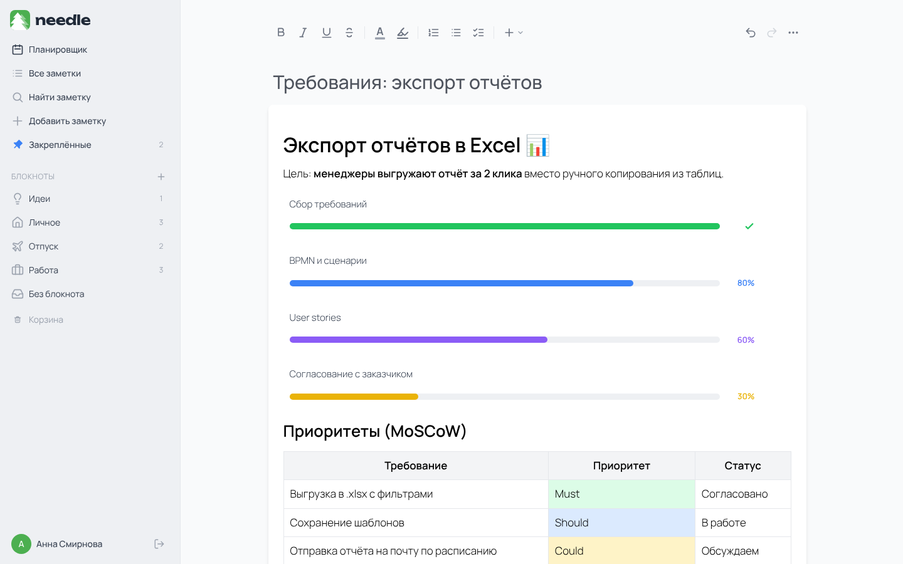
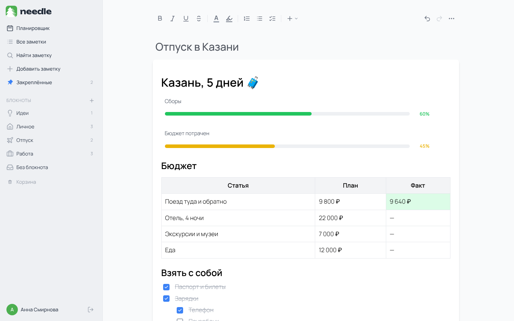
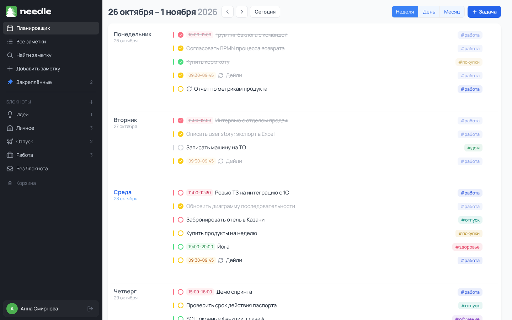
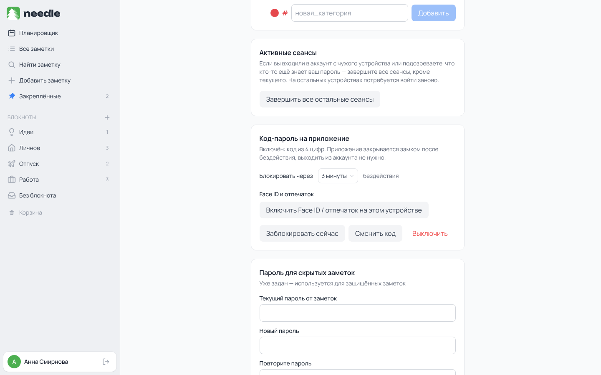
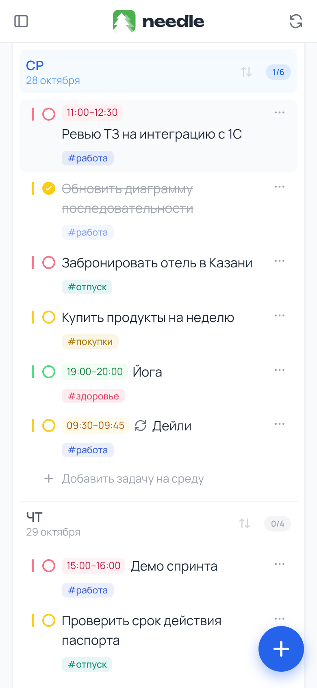
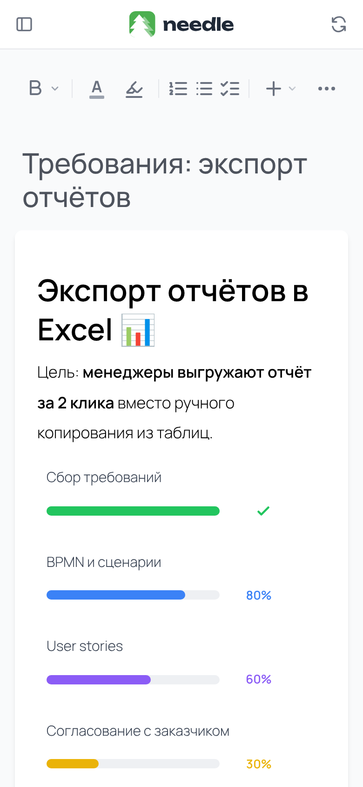

# Needle

**Планировщик задач и менеджер заметок в одном месте**

 

## Что это

Needle - русскоязычный планировщик для тех, устал держать список задач и заметок в разных местах. Задачи и заметки теперь живут рядом и могут ссылаться друг на друга.

## Возможности

- **Неделя, день и месяц.** Планируйте в нужном масштабе: сегодняшний день выделен, а прогресс дня виден сразу.
- **Задачи с приоритетами и повторами.** Цвет показывает важность, рядом - время и категория-хэштег; повтор по будням, неделям, месяцам или годам ставится один раз.
- **Заметки как рабочие документы.** Таблицы с цветными и объединёнными ячейками, вложенные чек-листы, прогресс-бары, картинки, файлы и блоки кода.
- **Всё связано.** Ссылка на заметку или задачу ставится через «@», эмодзи - через «:», а поиск находит нужное по тексту.
- **Порядок в заметках.** Блокноты с иконками, закреплённые заметки, корзина, из которой можно вернуть удалённое.
- **Личное остаётся личным.** Скрытые заметки под паролем и код-пароль на всё приложение с Face ID или отпечатком - без выхода из аккаунта.
- **На телефоне как приложение.** Needle ставится на главный экран и подстраивается под маленький экран.
- **Под себя.** Четыре темы оформления и подтягивание событий из Яндекс Календаря.

## Скриншоты

<table>
  <tr>
    <td width="50%"> <b>Неделя.</b> Приоритеты цветом, время, категории, повторяющиеся дела.</td>
    <td width="50%"> <b>Месяц.</b> Все дела месяца с цветом приоритета.</td>
  </tr>
  <tr>
    <td> <b>Заметка-документ.</b> Прогресс по этапам и приоритеты требований в таблице.</td>
    <td> <b>План поездки.</b> Бюджет в таблице, чек-лист вещей, ссылка на задачу.</td>
  </tr>
  <tr>
    <td> <b>Тёмная тема.</b> Одна из четырёх тем оформления.</td>
    <td> <b>Код-пароль.</b> Блокировка после бездействия, вход по коду или Face ID.</td>
  </tr>
  <tr>
    <td> <b>Телефон: неделя.</b> Сегодняшние дела крупно и под рукой.</td>
    <td> <b>Телефон: заметка.</b> Тот же редактор, что и на компьютере.</td>
  </tr>
</table>

## Стек

| Часть | Технологии |
| --- | --- |
| Фронтенд | React 19, TypeScript, Vite, Tailwind CSS, редактор TipTap 3, date-fns. Устанавливается на главный экран (PWA) |
| Бэкенд | Node.js, Express, PostgreSQL; сессии в базе, хэши паролей scrypt, WebAuthn для Face ID и отпечатка, письма через SMTP |

## Статус

Needle работает и развивается. Код закрыт - здесь только витрина продукта.
Связь: [Telegram](https://t.me/aemelianov)
